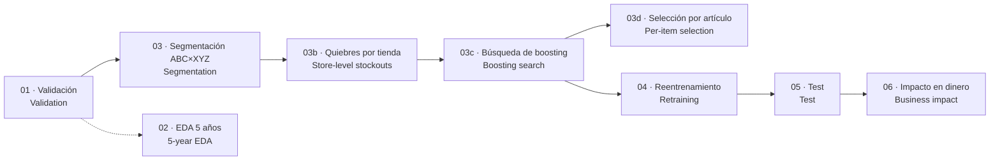

<div align="center">

# DDR · Demand Driven Replenishment

**Pronóstico de demanda con series de tiempo y machine learning sobre M5 (Walmart)**<br>
*Demand forecasting with time series and machine learning on Walmart's M5 dataset*


<!-- Imagen principal: guardar la figura en docs/img/hero.png y quitar este comentario.

-->

</div>

---

## Contenido · Contents

1. [El problema · The problem](#el-problema--the-problem)
2. [Resultados: un adelanto · Results: a sneak peek](#resultados-un-adelanto--results-a-sneak-peek)
3. [Flujo del proceso · Pipeline](#flujo-del-proceso--pipeline)
4. [Reglas de la casa · House rules](#reglas-de-la-casa--house-rules)
5. [Estructura · Repository structure](#estructura--repository-structure)
6. [Cómo reproducirlo · Getting started](#cómo-reproducirlo--getting-started)
7. [Datos · Data](#datos--data)
8. [Hoja de ruta · Roadmap](#hoja-de-ruta--roadmap)
9. [Autor y licencia · Author & license](#autor-y-licencia--author--license)

---

## El problema · The problem

Cada producto que falta en el anaquel es una venta perdida. Cada producto que sobra es dinero dormido. En retail, equivocarse cuesta dos veces, y la costumbre más extendida para no equivocarse (pedir lo mismo que se vendió el año pasado) tiene la elegancia de un método y la precisión de una corazonada.

> **EN.** Every product missing from the shelf is a lost sale; every extra one is idle cash. In retail, being wrong costs twice, and the most common way to avoid it (ordering whatever sold last year) has the elegance of a method and the precision of a hunch.

**Demand Driven Replenishment (DDR)** es un proyecto de **pronóstico de demanda** y de **pronóstico de ventas** (*demand forecasting*, *sales forecasting*) para el **abastecimiento** y el **control de inventarios** en retail. Combina **series de tiempo**, **machine learning** y **data science** sobre los datos reales de Walmart de la competencia **M5**: 3.049 productos, 10 tiendas y 5 años de ventas diarias.

> **EN.** **Demand Driven Replenishment (DDR)** is a **demand forecasting** and **sales forecasting** project for retail **inventory optimization** and **supply chain forecasting**. It combines **time series forecasting**, **machine learning** and **data science** on Walmart's real **M5** competition data: 3,049 products, 10 stores, 5 years of daily sales.

Un cero en las ventas no siempre significa que nadie quiso el producto. A veces significa que no había. Un modelo que no distingue entre falta de demanda y **quiebre de stock** aprende, con toda seriedad, que nadie quiere lo que nunca estuvo en el anaquel. Y no todos los productos merecen la misma atención: unos pocos sostienen el ingreso, y de esos, unos son predecibles y otros no.

> **EN.** A zero in the sales log does not always mean nobody wanted the product; sometimes it means there was none. A model that cannot tell missing demand from a **stockout** learns, with a straight face, that nobody wants what was never on the shelf. And not every product deserves the same attention: a few carry the revenue, and among those, some are predictable and some are not.

La meta: que la **planeación de la demanda** deje de ser un acto de fe. DDR identifica qué productos sostienen el ingreso y cuáles venden de forma estable, recupera la demanda que esconden los anaqueles vacíos, anticipa cuánto se venderá en cada periodo de 28 días y traduce el error del pronóstico a lo único que entiende un comité: dinero.

> **EN.** The goal: to turn **demand planning** into something other than an act of faith. DDR identifies which products carry the revenue and which sell steadily, recovers the demand hidden behind empty shelves, forecasts sales for each 28-day period, and translates forecast error into the only language a steering committee speaks: money.

---

## Resultados: un adelanto · Results: a sneak peek

Las cifras completas, con sus matices, viven en los notebooks. Aquí solo el tráiler.

> **EN.** Full figures, caveats included, live in the notebooks. Here is just the trailer.

| | Hallazgo · Finding | Dónde · Where |
|---|---|---|
| 💰 | **77 % menos inventario en exceso** con la misma disponibilidad del 95 %, frente a repetir el año anterior. *77% less excess inventory at the same 95% service level, versus repeating last year.* | [06 · Impacto](notebooks/06_reporte_final.ipynb) |
| 🎯 | **WRMSSE de 0,495** frente a 0,868 del seasonal naive en el año de test, medido una sola vez. *WRMSSE of 0.495 vs. 0.868 for seasonal naive on the test year, measured exactly once.* | [05 · Test](notebooks/05_evaluacion_backtesting.ipynb) |
| 🧩 | **"A cada producto su modelo" sonaba bien.** Perdió contra un solo modelo para todos. *"One model per product" sounded great. It lost to a single model for all.* | [03d · Selección](notebooks/03d_seleccion_por_articulo.ipynb) |
| 🔭 | **Pronosticar un año de una sola vez sale caro.** Cuánto, exactamente, está en el notebook. *Forecasting a whole year in one shot is expensive. Exactly how expensive is in the notebook.* | [05 · Test](notebooks/05_evaluacion_backtesting.ipynb) |
| 🕳️ | **De 3.049 productos, 517 llegan al modelo.** El embudo explica quién se quedó en el camino y por qué. *Of 3,049 products, 517 reach the model. The funnel explains who was left behind and why.* | [03 · Segmentación](notebooks/03_abc_xyz_train.ipynb) |

---

## Flujo del proceso · Pipeline



| Notebook | Pregunta que responde | Question it answers |
|---|---|---|
| `01` Validación | ¿Los datos dicen lo que parece que dicen? | Does the data say what it seems to say? |
| `02` EDA | ¿Qué tan estable es la demanda año tras año? | How stable is demand year after year? |
| `03` Segmentación | ¿Quién paga la fiesta y quién es predecible? | Who pays for the party, and who is predictable? |
| `03b` Quiebres | ¿Cuánta demanda esconden los anaqueles vacíos? | How much demand hides behind empty shelves? |
| `03c` Boosting | XGBoost, LightGBM o CatBoost: ¿cuál gana? | XGBoost, LightGBM or CatBoost: which one wins? |
| `03d` Selección | ¿Vale la pena un modelo por producto? | Is one model per product worth it? |
| `04` Reentrenamiento | ¿Qué aprende el modelo con todo el histórico? | What does the model learn from the full history? |
| `05` Test | ¿Cuánto se equivoca con datos que nunca vio? | How wrong is it on data it never saw? |
| `06` Impacto | ¿Cuánto dinero es eso? | How much money is that? |

---

## Reglas de la casa · House rules

- **Un NaN no es un cero.** Los días sin dato se enmascaran; los ceros se interrogan. *A NaN is not a zero: missing days are masked, zeros are questioned.*
- **El test se mira una sola vez.** Sin repechaje, sin "una ultimita corrida". *The test set is evaluated once. No second chances, no "just one more run".*
- **Las reglas se congelan.** La segmentación se calcula solo con entrenamiento y se guarda con hash SHA-256. *Rules are frozen: segmentation is fit on training data only and stored with a SHA-256 hash.*
- **Sin MAPE.** Con ventas en cero, dividir entre la venta real es una forma elegante de dividir entre cero. *No MAPE: with zero sales, dividing by actuals is an elegant way to divide by zero.*
- **Ningún resultado se sobrescribe por accidente.** Cada notebook tiene candado (`RERUN` / `OVERWRITE`). *No result gets overwritten by accident: every notebook is locked.*

---

## Estructura · Repository structure

```
.
├── data/                        # Fuera de Git · Not tracked
│   ├── raw/                     # M5 original · Original M5 files
│   ├── interim/                 # Intermedios y salidas por notebook · Per-notebook outputs
│   └── processed/               # Segmentación congelada (SHA-256) · Frozen segmentation
├── docs/                        # Documentación e imágenes · Docs and images
├── models/
│   └── nb04_catboost/           # CatBoost global + meta.json
├── notebooks/                   # 01 → 06, en orden · in order
├── reports/
│   ├── figures/                 # Figuras generadas · Generated figures
│   └── pronostico_reposicion/   # Informe final · Final report
├── src/
│   ├── config/                  # params.toml + historial · parameter history
│   ├── data.py                  # Carga, máscaras, persistencia · Loading, masks, I/O
│   ├── segmentation.py          # ABC, XYZ, rachas de ceros · zero runs
│   ├── store_treatment.py       # Quiebres por tienda · Store-level stockouts
│   ├── features.py              # Bloques de 28 días, rezagos · 28-day blocks, lags
│   ├── modeling.py              # Backtesting, boosting, SARIMAX
│   ├── metrics.py               # WRMSSE, WAPE, curvas de servicio · service curves
│   ├── freeze.py                # Congelamiento con hash · Hash freezing
│   └── tests/                   # pytest
├── LICENSE
├── pyproject.toml
├── requirements.txt
└── README.md
```

---

## Cómo reproducirlo · Getting started

```bash
git clone https://github.com/<usuario>/<repositorio>.git
cd <repositorio>
python -m venv .venv
source .venv/bin/activate        # Windows: .venv\Scripts\activate
pip install -r requirements.txt
```

1. **Datos · Data.** Descargar *M5 Forecasting – Accuracy* desde Kaggle y dejar `sales_train_evaluation.csv`, `calendar.csv` y `sell_prices.csv` en `data/raw/`. *Download M5 Forecasting – Accuracy from Kaggle and place those three files in `data/raw/`.*

   ```bash
   kaggle competitions download -c m5-forecasting-accuracy -p data/raw
   ```

2. **Notebooks.** Ejecutar en orden, de `01` a `06`. Cada uno lee lo que dejó el anterior. *Run them in order, `01` to `06`; each one reads what the previous one left behind.*
3. **Pruebas · Tests.**

   ```bash
   pytest src/tests
   ```

---

## Datos · Data

**M5 Forecasting – Accuracy** (Kaggle, 2020): ventas diarias por producto y tienda de Walmart en California, Texas y Wisconsin, con calendario de eventos y precios semanales. Los datos no se incluyen en el repositorio; su uso se rige por las reglas de la competencia.

> **EN.** **M5 Forecasting – Accuracy** (Kaggle, 2020): daily Walmart sales per product and store across California, Texas and Wisconsin, with an event calendar and weekly prices. The data is not included in the repository; its use is governed by the competition rules.

---

## Hoja de ruta · Roadmap

- [ ] Pronóstico por tienda y por región · *Store- and region-level forecasts*
- [ ] Extender el modelo al resto del catálogo · *Extend the model to the rest of the catalog*
- [ ] Pronóstico hacia adelante, más allá del periodo de test · *Forward-looking forecasts beyond the test period*

---

## Autor y licencia · Author & license

**José Gregorio Salas Bolívar** · Data scientist

Licencia: ver [LICENSE](LICENSE). · *License: see [LICENSE](LICENSE).*

Agradecimientos a los organizadores de la competencia M5 por publicar datos de retail reales, con todo y sus anaqueles vacíos. · *Thanks to the M5 competition organizers for releasing real retail data, empty shelves included.*
