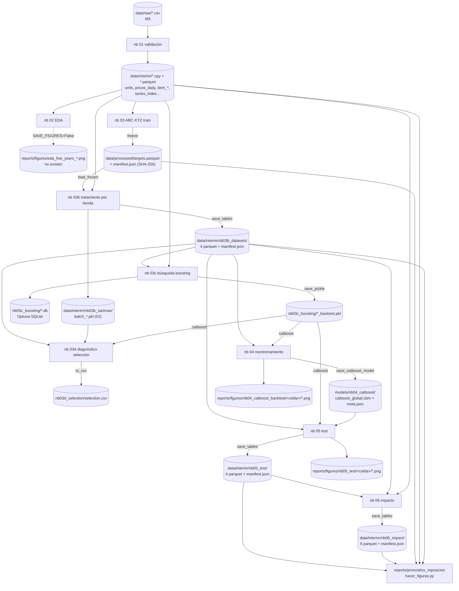

# Mapa del flujo de datos y de la persistencia

Fecha del relevamiento: 2026-11-13. Fuente: lectura de `src/` y de las celdas de código de los notebooks
(como JSON, sin ejecutarlos) e inspección del disco (esquemas Parquet, `sqlite_master`, claves de los
pickles, `head` de los CSV). Constitución 7.1.0.

## 1. Diagrama

Todas las rutas son relativas a la raíz del repo. Las lecturas de `data/interim/*.npy` pasan por
`src.data.load_interim(cfg, max_day)` (mmap recortado a `max_day`): nb 03b–05 usan `max_day = train_end`;
el nb 06 usa `data.last_day` (incluye test, solo para valorar).

## 2. Funciones de persistencia en `src/`

| Función | Archivo | Escribe | Candado |
|---|---|---|---|
| `save_data_validation` → `save_interim` | `src/data.py` | `.npy` y `.parquet` en `data/interim/` | ninguno (sobrescribe) |
| `freeze` / `load_frozen` | `src/freeze.py` | Parquet o JSON + entrada en `data/processed/manifest.json` (sha256, config_sha256, frozen_at, version) | falla si el artefacto ya está congelado en la misma `version`; `load_frozen` verifica el hash |
| `save_tables` / `load_tables` | `src/data.py` | `<dir>/<tabla>.parquet` + `manifest.json` (shapes, categorías, metadatos) | igual contenido → no escribe; distinto → `FileExistsError` salvo `overwrite=True`; `load_tables` verifica shapes |
| `save_pickle` | `src/data.py` | `pd.to_pickle` | igual que `save_tables` |
| `search_sarimax_checkpointed` / `load_sarimax_checkpoints` | `src/modeling.py` | `batch_NNNN.pkl` por lote de 10 artículos (escritura vía temporal) | reanuda desde los lotes existentes |
| `boosting_search(..., storage=)` | `src/modeling.py` | estudio Optuna en SQLite (`create_study(load_if_exists=True)`) | reanuda; se detiene si la configuración del estudio cambió |
| `save_catboost_model` / `load_catboost_model` | `src/modeling.py` | `catboost_global.cbm` + `meta.json` | igual modelo → no escribe; distinto → error salvo `overwrite` |
| `guard_rerun(paths, RERUN)` | `src/data.py` | — | detiene el notebook si sus salidas existen y `RERUN=False` |

## 3. Tabla maestra de artefactos

Estado: ✔ existe en disco, ✘ no existe. Git: `/data/` está ignorado entero (todo lo de `data/` queda
fuera del repo).

### 3.1 Entradas y comunes

| Ruta | Formato | Granularidad / llave · tamaño | Escrito por | Leído por | Estado |
|---|---|---|---|---|---|
| `data/raw/sales_train_evaluation.csv` | CSV | tienda×artículo, columnas `d_1…d_1941` (122 MB) | descarga M5 | `src.data.load_sales` (nb 01); `pd.read_csv(nrows=5)` en nb 01/02 | ✔ |
| `data/raw/calendar.csv` | CSV | día | M5 | `load_calendar` (nb 01, 02, 03, 03b, 03c, 03d, 04, 05, 06) | ✔ |
| `data/raw/sell_prices.csv` | CSV | tienda×artículo×semana (203 MB) | M5 | `load_prices` (nb 01) | ✔ |
| `data/raw/sales_train_validation.csv`, `sample_submission.csv` | CSV | — | M5 | nadie | ✔ (sin uso) |
| `data/raw/*:Zone.Identifier` | metadatos de Windows | — | descarga | nadie | ✔ (basura) |
| `src/config/params.toml`, `params_history.csv` | TOML / CSV | claves de parámetros | a mano / `src.config` | `load_validated_config` (todos) | ✔ versionado |
| `data/interim/units.npy`, `prices_daily.npy` | npy float32 | (30490 tienda×artículo, 1941 días) · 237 MB c/u | nb 01 · `save_data_validation` | `load_interim(series_level=True)` (nb 02, 03, 03b); `units.npy` también `hacer_figuras.py` | ✔ |
| `data/interim/item_units.npy`, `item_spend.npy` | npy float64 | (3049 artículos, 1941 días) | nb 01 | `load_interim` (nb 02, 03, 03b, 03c, 03d, 04, 05, 06; `hacer_figuras.py`) | ✔ |
| `data/interim/chain_total.npy`, `week_of_day.npy` | npy | (1941,) día | nb 01 | `load_interim` | ✔ |
| `data/interim/item_index.parquet` | Parquet | 3049 filas · `item_id`, `item_launch_d` | nb 01 | `load_interim`; `hacer_figuras.py` | ✔ |
| `data/interim/series_index.parquet` | Parquet | 30490 · `store_id`, `item_id`, `csv_row` | nb 01 | `load_interim(series_level=True)`; `hacer_figuras.py` | ✔ |
| `data/interim/mask_reason.npy` | npy int8 | (30490, 1941) · 59 MB | nb 01 | no se encontró lectura desde disco | ✔ (huérfano) |
| `data/interim/launch.parquet` | Parquet | 30490 · tienda×artículo · `launch_wk`, `launch_d` | nb 01 | no se encontró lectura desde disco | ✔ (huérfano) |
| `data/interim/rejections.parquet` | Parquet | 0 filas · `reason`, `source`, `row_id`, `column`, `detail` | nb 01 | nadie | ✔ (vacío) |

### 3.2 Segmentación (nb 03) — `data/processed/`, registro con hash

| Ruta | Formato | Granularidad / llave | Escrito por | Leído por | Estado |
|---|---|---|---|---|---|
| `data/processed/manifest.json` | JSON | `artifacts{name: path, sha256, config_sha256, frozen_at, version}`, `config_snapshot`, `declarations`, `version=v1` | `src.freeze.freeze` | `load_frozen`, `verify_manifest` | ✔ |
| `data/processed/targets.parquet` | Parquet | 592 artículos · `item_id`, `cell`, `abc_class`, `xyz_class`, `spend_train`, `spend_share`, `cv_train`, `long_run`, `min_days`, `treatment` | nb 03 (celda 133) · `freeze(..., "targets", ...)` | nb 03b · `load_frozen("targets")`; nb 04 superseded; `hacer_figuras.py` (lectura directa, sin hash) | ✔ |
| `data/processed/matrix_train.parquet` | Parquet | 3049 · `item_id`, `usage`, `spend`, `abc_class`, `cv`, `xyz_class`, `cell`, `exclusion_reason`… | `src.segmentation.run_train_matrix` (flujo viejo, 2026-10-31) | solo funciones viejas de `src/` (`stability.run_stability_stage`, `forecasting.final_report_tables`) | ✔ (huérfano) |
| `data/processed/train_cuts.json` | JSON | `abc_cuts=[0.6, 0.84]`, `xyz_thresholds=[21.1, 26.5]`, `abc_share_bounds` | `run_train_matrix` (flujo viejo) | solo `stability.run_stability_stage` | ✔ (huérfano) |
| `data/processed/zero_thresholds.parquet` | Parquet | 3049 · `item_id`, `n_days`, `p0`, `threshold`, `source`, `ww_z`, `ww_pvalue` | `run_train_matrix` (flujo viejo) | solo funciones viejas (`forecasting.run_backtesting_stage`, `stability.*`) | ✔ (huérfano) |

### 3.3 Modelado (nb 03b → 06)

| Ruta | Formato | Granularidad / llave · columnas | Escrito por | Leído por | Estado |
|---|---|---|---|---|---|
| `data/interim/nb03b_datasets/manifest.json` | JSON | `saved_at=2026-11-07T08:25:38`, `tables` (shapes), `categories`, `boost_features` (33), `cat_features` (`item_id`, `cell`, `period`), `sarimax_exog`, `n_items=517`, `n_folds=13`, `snaive_m=13`, `seed=42` | nb 03b (celda 154) · `save_tables` | `load_tables` (nb 03c, 03d, 04, 05, 06) | ✔ |
| `.../nb03b_datasets/boosting_data.parquet` | Parquet | 31164 = 517 artículos × bloque (28 d), bloques 2–65; `split` train 24443 / test 6721 (13 por artículo); `fold` 0 = historia, 1–13 = backtesting. Cols: `units`, `units_prev`, `ratio`, `ratio_raw`, `ratio_treated`, `imputed`, rezagos `ratio_lag{1,2,3,13}`, `ratio_roll{3,6,13}_{mean,std,median,range}`, eventos `n_*` y rezagos, `year`, `period`, `age`, `cell` | nb 03b · `src.features.boosting_dataset` + `save_tables` | nb 03c, 03d, 04, 05, 06; `hacer_figuras.py` | ✔ |
| `.../nb03b_datasets/sarimax_data.parquet` | Parquet | 31164 · artículo×bloque · `units`, `ratio*`, exógenas `n_*`, `fold` | nb 03b · `sarimax_dataset` | nb 03b (búsqueda SARIMAX); nb 03c la carga pero solo usa `boosting_data` | ✔ |
| `.../nb03b_datasets/snaive_valid.parquet` | Parquet | 6721 = 517 × 13 folds · `item_id`, `block`, `fold`, `units`, `snaive`, `error`, `cell` | nb 03b | nb 03c, 03d, 06 (σ del seasonal naive) | ✔ |
| `.../nb03b_datasets/rmsse_scale.parquet` | Parquet | 517 · `item_id`, `scale` | nb 03b | nb 03c, 03d, 04, 05, 06 | ✔ |
| `data/interim/nb03b_sarimax/batch_0000…0051.pkl` | pickle (dict) | 52 lotes × ≤10 artículos; claves `diffs` (pruebas OCSB/KPSS), `grid` (órdenes, AIC/AICc), `winners`, `backtest` (`item_id`, `block`, `fold`, `units`, `sarimax`), `choice`, `meta` | nb 03b (celda 162) · `search_sarimax_checkpointed` | nb 03d · `load_sarimax_checkpoints` | ✔ |
| `data/interim/nb03c_boosting/{xgboost,lightgbm,catboost}.db` | SQLite (Optuna) | 1 estudio por archivo (`study_name` = algoritmo), 100 pruebas COMPLETE c/u; tablas estándar de Optuna (`studies`, `trials`, `trial_params`, `trial_values`…) | nb 03c (celdas 19/31/43) · `boosting_search(storage="sqlite:///…")` | nadie fuera del nb 03c (sirve para reanudar/auditar) | ✔ |
| `data/interim/nb03c_boosting/{alg}_backtest.pkl` | pickle (dict) | `meta` (`algorithm`, `params`, `wrmsse`, `trial`, `n_trials`, `features`, `seed`, `saved_at`, `versions`) + `backtest` DataFrame 6721 = artículo×fold (`item_id`, `block`, `fold`, `units`, `units_prev`, `ratio_hat`, `pred`). CatBoost: prueba 43, WRMSSE 0,506 | nb 03c (celdas 24/36/48) · `save_pickle` | `catboost_backtest.pkl`: nb 03d, 04, 05. XGBoost/LightGBM: nadie después del 03c | ✔ |
| `data/interim/nb03d_selection/selection.csv` | CSV | 517 artículos · `item_id`, `cell`, `weight`, `sarimax_status`, `rmsse_{snaive,sarimax,catboost}`, `winner`, `winner_rmsse`, `winner_wape`, `winner_folds_1_7`, `winner_catboost_all` | nb 03d (celda 24) · `out.to_csv` directo | nadie (diagnóstico terminal, por diseño) | ✔ |
| `models/nb04_catboost/catboost_global.cbm` | CatBoost nativo | un modelo global (4,9 MB) | nb 04 (celda 25) · `save_catboost_model` | nb 05 · `load_catboost_model` (encadenado) | ✔ · ignorado (`models/**/*.cbm`) |
| `models/nb04_catboost/meta.json` | JSON | `features`, `cat_features`, `params`, `seed`, `fit` (24348 filas, bloques 2–52), `source` (03b, prueba 43), `versions`, `saved_at=2026-11-09T18:55:45` | nb 04 · `save_catboost_model` | nb 05 | ✔ · **versionado** |
| `data/interim/nb05_test/manifest.json` | JSON | `accepted=True`, `wrmsse_units` (a un paso 0,495; encadenado 0,748; seasonal naive 0,868), `source`, `tukey_k`, `versions`, `saved_at=2026-11-10T16:39:25` | nb 05 (celda 26) · `save_tables` | nb 06 (`load_tables`) | ✔ |
| `.../nb05_test/forecasts.parquet` | Parquet | 6721 = artículo×bloque de test (51–65), `step` 1–13 · `units`, `ratio_raw`, `ratio_treated`, `imputed`, `{ratio,units}_{snaive,1step,chain}` | nb 05 | nb 06 | ✔ |
| `.../nb05_test/item_metrics.parquet` | Parquet | 1034 = artículo×`form` (a un paso / encadenado) · `rmsse_*`, `wape_*`, `mae_*` (unidades y tasas), `rmsse_units_window`, `test_vs_window`, `outlier_*`, `review` | nb 05 | nb 06 (σ = `rmsse_units_window`); `hacer_figuras.py` | ✔ |
| `.../nb05_test/metrics.parquet` | Parquet | 102 = `nivel`×`form`×`segment`×`step` · `n_items`, `wrmsse`, `wape` | nb 05 | `hacer_figuras.py` (el nb 06 no la usa) | ✔ |
| `.../nb05_test/mae.parquet` | Parquet | 6 = `nivel`×`candidate` · `mean`, `median` | nb 05 | nadie | ✔ |
| `data/interim/nb06_impact/manifest.json` | JSON | `target_service=0.95`, `z_values` (−1 a 3, paso 0,25), `total_demand`, `headline`, `source` (nb05, nb03b), `saved_at=2026-11-10T17:20:15` | nb 06 (celda 34) · `save_tables` | informe final (pendiente) | ✔ |
| `.../nb06_impact/curves.parquet` | Parquet | 272 = `segment` (AX/AY/AZ/total) × `forecast` (4) × `z` (17) · `demand`, `captured`, `lost`, `excess`, `short_blocks`, `service` | nb 06 · `src.metrics.coverage_by_z` | `hacer_figuras.py` | ✔ |
| `.../nb06_impact/readings.parquet` | Parquet | 8 = escenario×segmento · lecturas a z95 y z=0 | nb 06 · `service_reading`, `lost_at_excess` | `hacer_figuras.py` | ✔ |
| `.../nb06_impact/item_impact.parquet` | Parquet | 1034 = artículo×`scenario` · `lost_*`, `excess_*`, `impacto*`, `z_*` | nb 06 | nadie todavía | ✔ |
| `.../nb06_impact/{by_segment,concentration,ab}.parquet` | Parquet | 8 / 2 / 4 filas (agregados por celda, escenario, A vs B) | nb 06 | nadie todavía | ✔ |

### 3.4 Figuras y reportes

| Ruta | Formato | Granularidad | Escrito por | Leído por | Estado / git |
|---|---|---|---|---|---|
| `reports/figures/nb04_catboost_backtest/{AX,AY,AZ}/<item_id>.png` | PNG 110 ppp | 517 (191/229/97) · ~82 MB | nb 04 (celda 16) · `plot_forecast_item` + `savefig` | nadie | ✔ · ignorado |
| `reports/figures/nb05_test/{AX,AY,AZ}/<item_id>.png` | PNG | 517 | nb 05 (celda 15) | nadie | ✔ · ignorado |
| `reports/figures/eda_five_years_{pareto,radar,psi_interannual}.png` | PNG | 3 | nb 02 (si `SAVE_FIGURES=True`; hoy `False`) | nadie | ✘ |
| `reports/tratamiento_quiebres_atipicos.pptx` | PPTX | deck | externo al flujo de notebooks | — | ✔ · versionado |
| `reports/pronostico_reposicion/` | scripts, `datos/*.csv` (10), `figuras/*.png` (9), `.pptx` | informe final en curso | `hacer_figuras.py`, `datos_estabilidad.py`, `construir_deck.js` | — | ✔ · sin seguimiento (no ignorado) |

Nb 03c, 03d y 06 no guardan figuras (solo en línea).

### 3.5 Rutas declaradas en `src/` sin productor activo (flujo viejo)

| Ruta | Función que la escribe / lee | Estado |
|---|---|---|
| `models/frozen_models.json`, `models/baseline_models.json`, `models/fit_failures.parquet`, `data/processed/backtest_scores.parquet` | `src.forecasting.run_backtesting_stage` | ✘ |
| `data/processed/forecasts_test.parquet`, `data/processed/evaluation.parquet` | `src.forecasting.run_test_evaluation_stage`, `final_report_tables` | ✘ |
| `data/processed/{matrices_by_set,stability,item_stability,segmentation_params}.*` (+ `targets`) | `src.stability.run_stability_stage` | ✘ (salvo `targets`) |
| `data/processed/{matrix_y5,stability_y5,year5_replication}.parquet` | `src.stability.run_replication`; leídos por `final_report_tables` | ✘ |
| `reports/eda_five_years/*.parquet` | `src.stability.run_eda_five_years` | ✘ |
| `data/processed/test_ledger.json` | `src.freeze.TestLedger` | ✘ (ningún notebook lo usa) |
| `data/processed/nb04_sarimax.csv`, `nb04_boosting.csv` | nb 04 superseded (celda 110) · `to_csv` | ✔ 35145 filas c/u, 17 MB · nadie los lee |

## 4. Candados

| Notebook | Mecanismo | Rutas vigiladas |
|---|---|---|
| nb 01 | ninguno | sobrescribe `data/interim/*` |
| nb 03 | `freeze` (falla si ya congelado en `v1`) | `targets` |
| nb 03b | `guard_rerun` + `RERUN`/`OVERWRITE` | `nb03b_datasets/manifest.json`, `nb03b_sarimax/` |
| nb 03c | `guard_rerun` + `save_pickle(overwrite=OVERWRITE)` | los tres `*_backtest.pkl` (no los `.db`) |
| nb 03d | **ninguno** | `selection.csv` se sobrescribe sin aviso |
| nb 04 | `guard_rerun` + `save_catboost_model(overwrite=)` | `.cbm`, `meta.json` |
| nb 05 | `guard_rerun` + `save_tables(overwrite=)` | `nb05_test/manifest.json` |
| nb 06 | `guard_rerun` + `save_tables(overwrite=)` | `nb06_impact/manifest.json` |

## 5. Inconsistencias y riesgos

1. **nb 03d sin candado.** CLAUDE.md y la constitución dicen que 03b/03c/03d/05 tienen `RERUN`/`OVERWRITE`;
   el 03d no llama a `guard_rerun` y escribe con `to_csv` directo.
2. **Artefactos huérfanos en `data/processed/`:** `matrix_train.parquet`, `train_cuts.json`, `zero_thresholds.parquet`
   vienen de `run_train_matrix` (flujo viejo, congelados el 2026-10-31) y siguen en el manifiesto con hash, pero
   ningún notebook vigente los lee. `train_cuts.json` (ABC 0,60/0,84; XYZ 21,1/26,5) no coincide con
   `params.toml` (0,80/0,95; 10/25); no se pudo confirmar desde el código si coincide con los cortes del nb 03
   (que los calcula en línea y solo congela `targets`). Riesgo de confusión sobre cuál es el corte vigente.
3. **CSV del nb 04 superseded** (`data/processed/nb04_{sarimax,boosting}.csv`, 17 MB): escritos, nunca leídos.
4. **Código muerto con rutas inexistentes** (§3.5): `run_backtesting_stage`, `run_test_evaluation_stage`,
   `final_report_tables`, `run_stability_stage`, `run_replication`, `run_eda_five_years`, `TestLedger`. Ninguno
   rompe el flujo vigente, pero `final_report_tables` fallaría si se usara para el informe.
5. **Salidas del nb 01 sin lector:** `mask_reason.npy` (59 MB), `launch.parquet`, `rejections.parquet` (0 filas).
   `load_interim` no los carga; no se encontró lectura desde disco en `src/` ni en nb 03b–06.
6. **Insumos crudos sin uso:** `sales_train_validation.csv`, `sample_submission.csv` y los `:Zone.Identifier`.
7. **Lecturas sin verificación de hash fuera del flujo:** `hacer_figuras.py` lee `targets.parquet` con
   `read_parquet` (no `load_frozen`) y las tablas de nb 05/06 sin `load_tables` (sin chequeo de shapes).
8. **Salidas sin consumidor (todavía):** `nb05_test/mae.parquet`, `nb06_impact/{item_impact,by_segment,concentration,ab}.parquet`,
   los estudios `.db` y `xgboost/lightgbm_backtest.pkl` (documentales, por diseño), `selection.csv` (diagnóstico
   terminal; el nb 04 no lo lee, coherente con 7.1.0).
9. **nb 02:** `SAVE_FIGURES=False` y las celdas 13 y 18 guardan el mismo `eda_five_years_pareto.png` (la segunda
   sobrescribe a la primera).
10. **Flujo 03→06:** no hay dependencias rotas; todas las rutas leídas por nb 03b–06 existen. La cadena de
    trazabilidad se sostiene por `saved_at`/`source` en los manifiestos (03b → 03c → 04 → 05 → 06), no por hash:
    solo `targets` tiene SHA-256.
11. **Git:** `/data/` ignorado entero → no se versionan los manifiestos (ni el de hashes de `data/processed/`), ni
    `selection.csv`, ni las tablas de nb 05/06 de las que sale el informe. Lo único versionado del modelado es
    `models/nb04_catboost/meta.json`; el `.cbm` y las PNG están ignorados (se regeneran). `reports/pronostico_reposicion/`
    no está versionado ni ignorado.
